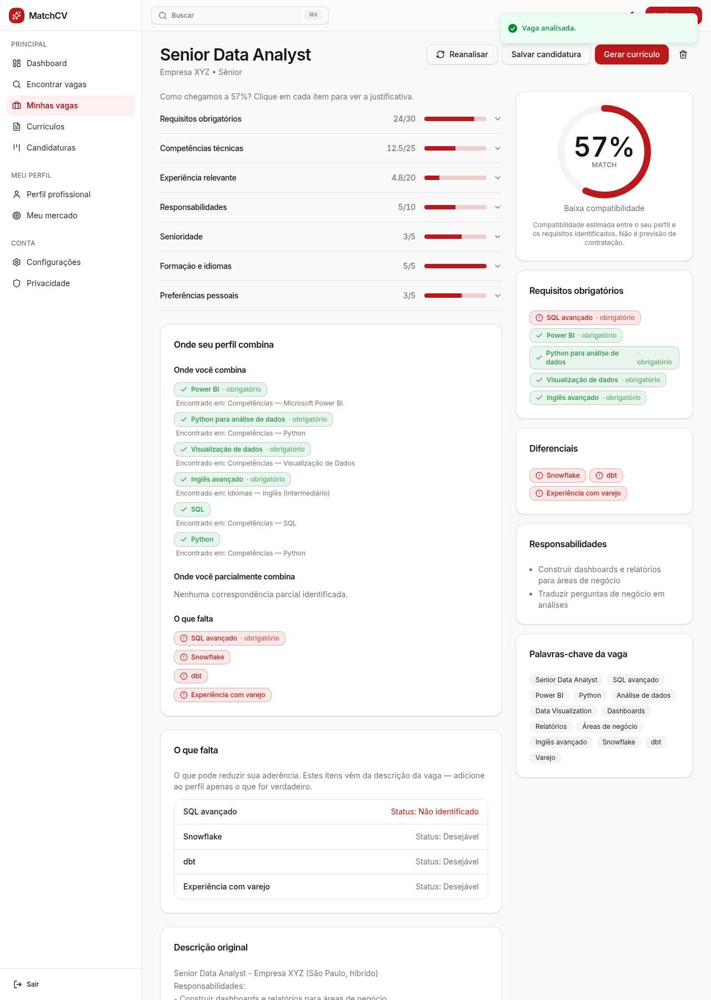
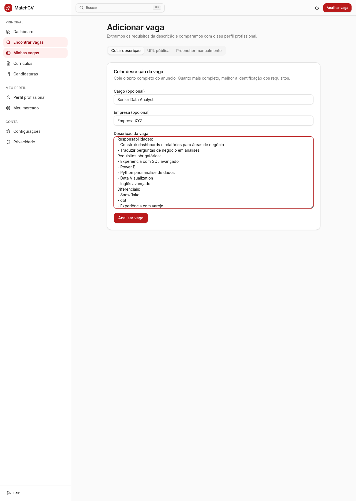
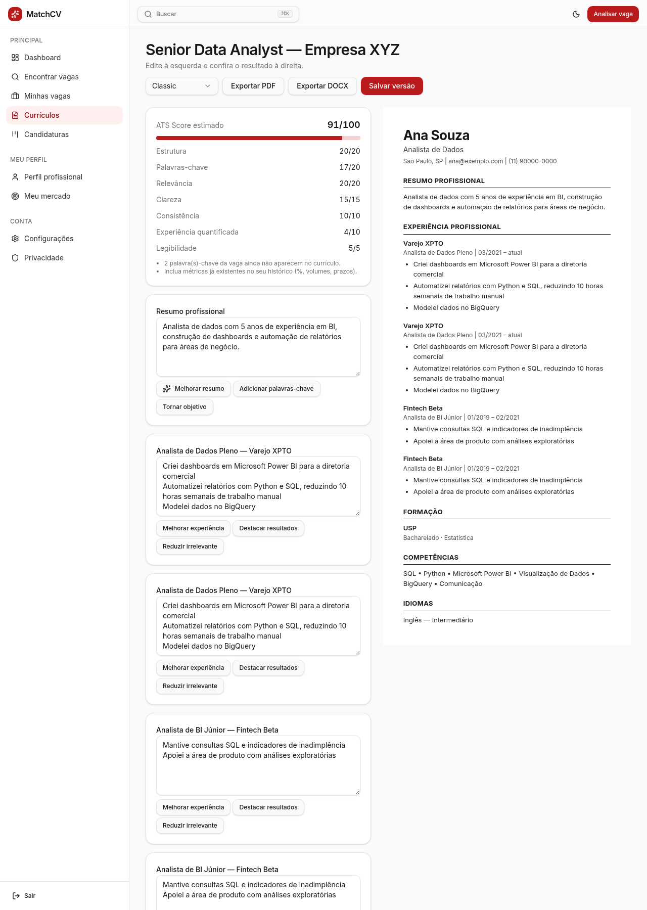
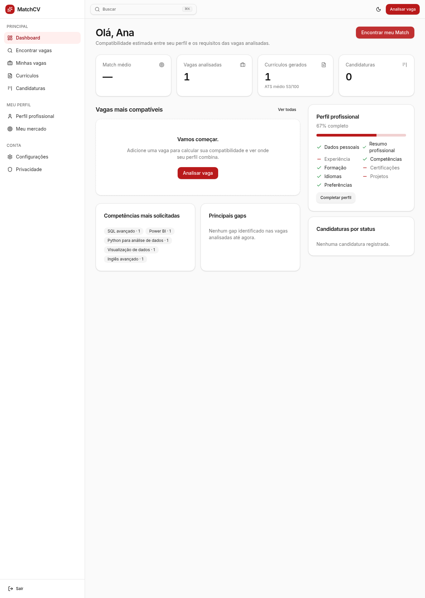

# MatchCV — Match de vagas + currículo ATS-friendly

**Aplicação publicada:** https://match-your-next-role.lovable.app



## 1. Qual problema resolve

Quem procura emprego costuma mandar o mesmo currículo para vagas muito diferentes e não sabe:
- o quanto o seu perfil combina de verdade com cada vaga;
- quais requisitos faltam (e quais são só diferença de nome, como "Power BI" e "Microsoft Power BI");
- como adaptar o currículo para cada vaga sem inventar nada e sem quebrar a leitura dos sistemas de triagem (ATS).

O MatchCV junta isso num fluxo só: você monta um **perfil profissional mestre** uma vez, cola uma vaga, vê um **score de compatibilidade explicado** (com a evidência de cada ponto), vê os **gaps** e gera um **currículo adaptado** à vaga, com **ATS Score estimado**, edição, exportação em PDF/DOCX e acompanhamento da candidatura num kanban.

> O score é uma compatibilidade estimada entre o perfil e os requisitos identificados. Ele não prevê contratação nem garante entrevista.

## 2. O mega prompt e o que mudou até a versão final

O projeto começou com um único mega prompt (em português) pedindo um SaaS completo, não um protótipo. Resumo do que ele exigia:

- **Papéis:** designer de produto/UX/UI sênior, engenheiro full-stack, PM de recrutamento e especialista em ATS.
- **Regra central:** nunca inventar experiências, competências, cargos, resultados, certificações ou idiomas.
- **Fluxo:** criar conta → importar currículo → extrair perfil → revisar → adicionar vaga → analisar → ver match e gaps → gerar currículo → revisar → exportar → acompanhar candidatura.
- **Match híbrido** (regras + sinônimos) com pesos configuráveis: obrigatórios 30%, competências 25%, experiência 20%, responsabilidades 10%, senioridade 5%, formação/idiomas 5%, preferências 5%; faixas Excelente / Alta / Moderada / Baixa / Pouca.
- **ATS Score:** estrutura 20, palavras-chave 20, relevância 20, clareza 15, consistência 10, experiência quantificada 10, legibilidade 5.
- **Design:** vermelho #B91C1C como cor de ação, fundos neutros, dark mode, fonte Inter, shadcn/ui como único design system.
- **Dados:** banco relacional normalizado, cada pessoa vê só os próprios dados, opção de excluir a conta e todos os dados (LGPD).

O que mudou entre o prompt e a versão final (decisões tomadas durante a construção):

| No prompt | Na versão final | Motivo |
|---|---|---|
| "Funções de IA" separadas (parseResume, analyzeJob, calculateMatch, ...) | Só a **leitura** (currículo e vaga) e a **reescrita de texto** usam IA. O **score e o ATS Score são calculados por regras** no código. | O score precisa ser reproduzível e explicável; um modelo de linguagem daria números diferentes a cada execução. |
| Análise sempre por IA | Se a IA estiver desligada (Privacidade) ou falhar, entra um **analisador local por regras**. | O app continua funcionando e respeita a escolha de quem desliga a IA. |
| Upload de arquivo enviado ao servidor | PDF/DOCX são **lidos no navegador** e só o texto é enviado para estruturar. | Menos dados pessoais trafegando e nenhum arquivo guardado. |
| URL de vaga | Lê **somente páginas públicas**; se a página exigir login ou anti-robô, pede para colar o texto. | Pedido explícito do prompt de não contornar CAPTCHA/autenticação. |
| Exportar PDF | PDF via impressão do navegador com estilo próprio para impressão (texto selecionável, uma coluna); DOCX gerado no navegador. | Garante texto real (não imagem), que é o que os ATS leem. |

## 3. Como a análise funciona — da vaga colada ao currículo ajustado

```text
Vaga colada ──► Extração de requisitos ──► Match com o perfil ──► Gaps ──► Currículo da vaga ──► ATS Score ──► Edição/IA ──► PDF/DOCX
```

1. **Vaga colada** (`/jobs/new`): você cola o texto (ou informa URL pública, ou preenche manualmente). A vaga é salva.
   
2. **Extração** (`src/lib/ai.functions.ts` → `analyzeJobAI`, com fallback `src/lib/job-parser.ts`): o modelo devolve um JSON com requisitos obrigatórios, desejáveis, tecnologias, soft skills, responsabilidades, palavras-chave, formação, idiomas e senioridade — só o que está escrito na vaga. O servidor valida e limpa o JSON.
3. **Match** (`src/lib/matching.ts` → `calculateMatch`): cada requisito é procurado no perfil mestre (competências, experiências, formação, certificações, idiomas). Termos são normalizados e comparados com uma tabela de sinônimos PT/EN. Cada item vira **combina / combina parcialmente / falta**, sempre com a **evidência** ("Encontrado em: Experiência — Analista de Dados Pleno @ Varejo XPTO"). Os pontos de cada critério são somados com os pesos do prompt.
4. **Gaps** (`GapAnalysis` em `src/components/product/match-breakdown.tsx`): o que falta é separado em obrigatório não identificado, parcial e desejável — com o aviso de adicionar ao perfil só o que for verdadeiro.
5. **Currículo da vaga** (`src/lib/resume-builder.ts` → `buildResumeContent`): não cria conteúdo; **reordena** experiências e competências pelo que a vaga pede e monta um documento de uma coluna com títulos tradicionais.
6. **ATS Score** (`src/lib/ats.ts` → `calculateAtsScore`): nota estimada por critério com dicas ("2 palavras-chave da vaga ainda não aparecem no currículo").
   
7. **Ajuste com IA** (`rewriteTextAI`): botões como "Melhorar resumo" e "Destacar resultados" mostram uma **sugestão antes de aplicar**. Se a melhoria dependeria de algo que não existe no perfil (ex.: um número de resultado), a IA lista isso e o app pergunta **"Você possui essa informação?"** em vez de inventar.
8. **Exportar e acompanhar**: PDF/DOCX, versões salvas (com restaurar) e a vaga vai para o kanban de candidaturas.

Painel geral:


### Exemplo de uso real (o que gerou os prints)

- Perfil de teste: "Ana Souza", analista de dados, com SQL, Python, Microsoft Power BI, BigQuery, Visualização de Dados, inglês intermediário.
- Vaga colada: *Senior Data Analyst — Empresa XYZ*, pedindo SQL avançado, Power BI, Python, Data Visualization, inglês avançado; diferenciais Snowflake, dbt e varejo.
- Resultado: **74% — compatibilidade moderada**. "Power BI" casou com "Microsoft Power BI" e "Data Visualization" com "Visualização de Dados" via sinônimos. Gaps: SQL avançado (obrigatório), Snowflake, dbt, varejo.
- Currículo gerado: **ATS Score estimado 91/100**, com a dica de incluir métricas já existentes no histórico.

### Limitações conhecidas (vistas nesse teste)

- **Nível de idioma:** "Inglês avançado" foi aceito com um perfil "Inglês intermediário". O match ainda não compara níveis.
- **Requisito com qualificador:** "SQL avançado" apareceu como falta mesmo com SQL no perfil; o certo seria "parcial".

Essas são as próximas correções planejadas no motor de match.

## 4. Ajustes pedidos depois da primeira geração, e por quê

Depois do mega prompt houve **um** pedido de ajuste: este README, com evidência de que a aplicação roda (prints, exemplo real e endereço publicado), porque para portfólio a prova de funcionamento pesa mais que a descrição.

Ajustes feitos durante a construção, encontrados nos testes:
- **Falta de informação no perfil:** gerar currículo sem experiências nem competências agora é bloqueado com uma mensagem, em vez de criar um documento vazio.
- **Dados enviados ao banco:** as gravações de análise, match e currículo foram ajustadas ao formato aceito pelo banco (antes falhavam na checagem de tipos).
- **Configurações:** erro de digitação que impedia a página de abrir foi corrigido.
- **Selos de requisito:** passaram a mostrar o status real (combina/falta) vindo do match, em vez de sempre "falta".

## 5. Tecnologias

React 19, TypeScript, TanStack Start, Tailwind CSS 4, shadcn/ui, ícones Lucide, Lovable Cloud (banco Postgres com regras de acesso por usuário, autenticação por e-mail/senha e Google, funções no servidor) e Lovable AI para a leitura de textos. Leitura de PDF com `pdfjs-dist`, DOCX com `mammoth` e geração de DOCX com `docx`.

## 6. Estrutura

```text
src/
  routes/                 páginas (landing, auth, e área logada em _authenticated/)
  components/product/     componentes do domínio (scores, badges, match, currículo, estados)
  components/layout/      shell da aplicação e tema claro/escuro
  components/ui/          shadcn/ui
  lib/                    matching, ATS, parser de vagas, construtor de currículo, IA, exportação, consultas
docs/screenshots/         prints usados neste README
```

## 7. Segurança e privacidade

- Nenhuma chave secreta está no repositório. O arquivo `.env` contém só a URL do backend e a **chave publicável** (feita para ficar no navegador); a chave de IA e as chaves de administrador ficam só no servidor.
- Toda tabela tem regra de acesso: cada pessoa lê e altera somente os próprios registros.
- "Excluir minha conta e todos os meus dados" apaga perfil, vagas, matches, currículos, candidaturas, registros de IA e o login.
